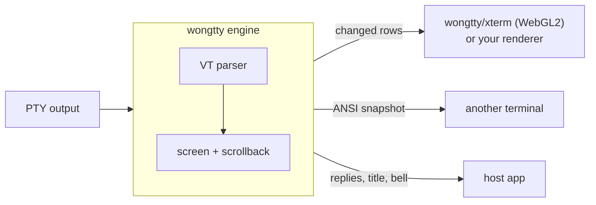

<div align="center">

# wongtty — a Rust terminal engine for wasm, Node and native apps

**Diffed cell by cell against xterm.js. Scrollback at about 100 bytes a line.**

Feed it PTY bytes. It keeps the screen and tells your renderer which rows changed.
Or use `wongtty/xterm`, the xterm.js API with a WebGL2 renderer, also in Rust.

[](https://github.com/openwong2kim/wongtty/actions/workflows/ci.yml)
[](LICENSE-APACHE)


[Measurements](#measurements) · [Quick start](#quick-start) · [xterm.js API](#wongttyxterm-the-xtermjs-api) · [The model](#the-model) · [xterm.js parity](#xtermjs-parity) · [Roadmap](#roadmap)

</div>

---

wongtty (**ox**ide + **tty**) parses the bytes a program writes to its PTY and
holds everything a terminal knows: characters, colours, cursor, modes and
scrollback. The engine does not draw anything. Your renderer asks which rows
changed and redraws only those.

For the browser there is [`wongtty/xterm`](#wongttyxterm-the-xtermjs-api): the
xterm.js `Terminal` API over the same engine, with its renderer, input,
selection, links, search and images written in Rust and compiled to a second
WebAssembly module. Its first goal is memory with many terminals open: with 17
panes of 10,000 lines of scrollback, the browser's renderer process grows by
less than a third of what it grows by with xterm.js
([measurements](#measurements)).

The parser and screen model are Alacritty's (`alacritty_terminal` 0.26, built
in and patched to behave like xterm.js). The same engine runs in a native
daemon, in the browser and in an Electron renderer, so the daemon's snapshot
and the screen in your browser cannot disagree about what a byte stream means.



## Highlights

- **One engine, three hosts.** Rust crate, WebAssembly npm package with no
  dependencies, and an N-API binding with the same API.
- **Damage, not frames.** `takeDamage()` returns the rows that changed. When
  output scrolls, it says how far to move the drawn picture first, so only the
  new rows are read.
- **Snapshots that resume.** `ansiSnapshot()` returns bytes that rebuild the
  screen, scrollback, cursor, pen and modes in another terminal, including an
  unfinished escape sequence, so live output can continue right after it.
- **Compressed scrollback.** History older than the newest 16 lines is stored
  as UTF-8 text plus runs of equal attributes: a 120-column log line takes
  about 100 bytes instead of 1440 in xterm.js. Rows decode on read.
- **Built for TUIs.** Synchronized output (`CSI ? 2026 h`), used heavily by
  coding agents, holds frames until the program ends the update.
- **xterm.js API in the browser.** `wongtty/xterm` mirrors the xterm.js 6.x
  `Terminal`, with fit, search, web links, WebGL and images built in. All
  panes on a page share one WebGL2 context and one glyph atlas, so a 17th pane
  does not run into Chrome's limit of 16 contexts.
- **Checked against xterm.js.** Every fixture is fed to wongtty and to
  `@xterm/headless`, and the test fails on any difference that is not listed
  with a reason.

| Where | Package | Notes |
| --- | --- | --- |
| Rust | crate [`wongtty`](crates/wongtty) | the engine |
| Browser, Electron renderer, Node | npm [`wongtty`](packages/wongtty) | WebAssembly engine, no dependencies |
| Browser, Electron renderer | npm [`wongtty/xterm`](#wongttyxterm-the-xtermjs-api) | xterm.js API, WebGL2 renderer, second WebAssembly module |
| Node / Electron main, daemons | [`crates/wongtty-node`](crates/wongtty-node) | N-API binding, same API |

## Measurements

Compared with xterm.js 6.1 betas. Lower is better.

**Many terminals in a browser** — 17 panes of 120×40, each with 10,000 lines
of scrollback filled, `wongtty/xterm` against `@xterm/xterm` with
`@xterm/addon-webgl`, in headless system Chrome on the real GPU. Memory the
renderer and GPU processes gained over an empty page, and the JS heap after a
GC. Apple M4, macOS, 2026-11-01/02.
`npm run bench:memory` in `packages/wongtty` reproduces it
([bench/memory](packages/wongtty/bench/memory)).

| | wongtty/xterm | xterm.js |
| --- | ---: | ---: |
| Renderer process | +119 MB | +413 MB |
| GPU process | +11 MB | +38 MB |
| JS heap | 3 MB | 41 MB |

RSS moves between runs, the GPU process the most: another run on 2026-11-02
gave +123 against +413 MB for the renderer and +21 against +48 MB for the GPU
process.

**Idle with a blinking cursor** — the same 17 panes, the first one focused
with `cursorBlink` on, GPU process footprint (macOS `footprint`) after 10 s.
A blinking cursor is a layer whose opacity flips, so the pane makes no WebGL
draw; Chromium then purges the GPU memory a periodic WebGL redraw keeps in
use. Apple M4, 2026-11-02, same bench.

| | wongtty/xterm | xterm.js |
| --- | ---: | ---: |
| Blink on | 216 MB (366 MB before the layer) | 437 MB |
| Blink off | 217 MB | 315 MB |
| WebGL draw calls in 10 s, blink on | 0 (60 before) | 43 |

**In wmux** — wmux (Electron) with 17 panes and 10,000 lines of scrollback,
the xterm.js renderer against wongtty, three alternating runs, macOS footprint
figures. Apple M4, 2026-11-01/02.

| | xterm.js | wongtty | |
| --- | ---: | ---: | ---: |
| Renderer process footprint | 297 MB | 139 MB | −53% |
| App footprint | 695 MB | 546 MB | −21% |
| JS heap | 82.5 MB | 21.0 MB | |
| WebAssembly memory | 7.9 MB | 54.0 MB | |
| GPU process footprint | 259 MB | 276 MB | +17 MB, not yet attributed |

The cells and scrollback move from the JS heap into WebAssembly memory, where
they take less room.

**Viewport-only mode** — the same bench with each pane keeping 200 lines of
scrollback and reading older lines from a history provider
(`setHistoryProvider`), as wmux's daemon would serve them, against the
default `wongtty/xterm` holding all 10,000 lines. Renderer process memory over
an empty page (macOS physical footprint, which counts the memory the system
compresses; RSS in brackets) and the two WebAssembly memories. Apple M4,
2026-11-02, two runs each, equal to the MB.
`npm run bench:memory -- 17 10000 wongtty,viewport` reproduces it.

| Panes | | default | viewport-only |
| --- | --- | ---: | ---: |
| 17 | Renderer footprint (RSS) | +86 MB (+117) | +26 MB (+58) |
| 17 | Engine wasm memory | 69 MB | 9 MB |
| 17 | Front-end wasm memory | 8 MB | 8 MB |
| 20 | Renderer footprint (RSS) | +100 MB (+130) | +29 MB (+61) |
| 20 | Engine wasm memory | 81 MB | 13 MB |
| 20 | Front-end wasm memory | 9 MB | 9 MB |

The JS heap stays at 3 MB in both modes; rows fetched for the view are kept
as JS arrays, at most 256 per pane by default.

**Engine memory for 17 terminals** — each parser used to reserve 2 MiB to
hold synchronized updates. Since the engine applies them at once, as xterm.js
does, 17 terminals take 5.1 MiB of engine memory instead of 41.1 MiB
(2026-11-02).

**Download size** — built 2026-11-03, gzip −9.

| Module | Bytes | gzip | Budget |
| --- | ---: | ---: | --- |
| Engine `wongtty.wasm` | 355,767 | 133,637 | 360 KiB raw, 135 KiB gzip |
| Front end `xterm_web_bg.wasm` (`wongtty/xterm` only) | 785,800 | 297,852 | 800 KiB raw, 300 KiB gzip |

One instance of each serves every terminal on a page, so the code is paid
once, not per pane. `scripts/build-web.sh` and `test/web/size.test.mjs` fail
over budget.

**Buffer memory** — Node, 8 terminals of 120×40 with 10,000 lines of
scrollback, wongtty (wasm) against `@xterm/headless`.

| Output | wongtty | xterm.js |
| --- | ---: | ---: |
| Log lines | 24 MiB | 143 MiB |
| Hangul lines | 32 MiB | 143 MiB |
| A different colour in every cell | 24 MiB | 24 MiB |

**Parser throughput** — MiB/s, higher is better. Node 22 on an Apple M4,
120×40 with 10,000 lines of scrollback, 8 MiB of generated output per row fed
in 64 KiB chunks, the median of 3 runs, each the median of 5 passes
(2026-11-03, load 2.1–2.3). All three end on the same screen. Native here is
the N-API module called from Node; [Against other engines](#against-other-engines)
calls the engine from Rust.
`node --expose-gc packages/wongtty/bench/throughput.mjs` reproduces it after
building the wasm and N-API modules.

| Output | wongtty native | wongtty wasm | xterm.js headless |
| --- | ---: | ---: | ---: |
| Log lines, some colour | 499 | 318 | 96 |
| Truecolor fg and bg in every cell | 743 | 548 | 142 |
| Hangul, CJK and emoji | 319 | 252 | 101 |
| Cursor jumps (TUI redraw) | 528 | 291 | 110 |
| Scrolling region (DECSTBM) | 503 | 337 | 41 |
| Short lines into scrollback | 311 | 196 | 59 |

**Compressed history outside the engine** — with
[`TermHistory`](#compressed-history-for-your-own-term), replaying an 8 MB
output ring into 100,000 lines of scrollback peaked at 11 MiB, against 143 MiB
for xterm.js headless (wmux daemon experiment, local).

**The cost.** Each line that scrolls off is compressed on its way into
history. Natively, against the same engine keeping history uncompressed (see
[Against other engines](#against-other-engines)):

- While history fills for the first time, the uncompressed engine also
  allocates and faults in 30 MiB of rows. Compression then costs 3% on agent
  log lines with emoji, 5% on short lines, 22% on Hangul lines and 26% on long
  wrapped lines; on log lines the compressed engine is faster, 510 against 406
  MiB/s.
- Once history is full, as it is in every terminal that runs for a while, it
  costs more: 13% on log lines (515 against 595 MiB/s), 12% on short lines
  (319 against 362), 31% on agent log lines with emoji (276 against 397), 33%
  on Hangul lines (321 against 478) and 50% on long wrapped lines (335 against
  669). The history takes 0.8–2.0 MiB of RSS against 30.2 MiB uncompressed.

The full-history figures come from `--steady`: the median of 3 interleaved
rounds, each the median of 5 passes, load 2.1–2.6. Compression explains part
of the pinned Ghostty's lead on Hangul (334 MiB/s; wongtty uncompressed runs
395 on the first fill); Ghostty main, at 567, is ahead of both.

**Many panes in a browser** — 20 panes of 120×40 on one page, all in view
and all printing; system Chrome on the GPU, Apple M4, 2026-11-02, median of 3
runs (within 7% of each other). Flat out, each pane gets its next 16 KiB as
soon as a write callback reports one parsed, so the main thread never idles;
the figure is the output parsed per second over all panes.
`npm run bench:speed` in `packages/wongtty` reproduces it, with 17 panes too,
write-to-frame latency, frame rate, long tasks and main-thread time.

| Output, flat out (MiB/s) | wongtty/xterm | xterm.js + WebGL | ghostty-web 0.4.0 |
| --- | ---: | ---: | ---: |
| Log lines | 148 | 90 | 24 |
| Truecolor in every cell | 77 | 62 | 7 |
| Hangul, CJK and emoji | 103 | 93 | 26 |
| Cursor jumps (TUI redraw) | 177 | 154 | 16 |
| Scrolling region | 168 | 40 | 27 |

At an agent's pace, 2 KiB per pane every 50 ms, wongtty/xterm and xterm.js both
draw 60 frames a second with output on screen 13–15 ms after `write`
(median; 95th percentile 21–25 ms). With a different truecolor in every cell
on 20 panes, wongtty/xterm draws 58 frames (95th percentile 29 ms) against
xterm.js's 59 (24 ms). ghostty-web, drawing on a 2D canvas,
runs at 20–53 frames a second (95th percentile 85–141 ms).

### Against other engines

This compares engines: bytes go in and a screen model comes out. On memory,
wongtty grew the least of any engine on all seven outputs that keep history,
by 0.7–3.2 MiB, against 10.6–22.2 MiB for Ghostty and 10.0–12.5 for Rio;
Alacritty, which keeps history uncompressed, grew 30–44 MiB on each output
that filled 10,000 lines. On speed, wongtty is the fastest engine on truecolor
(2.0× Ghostty main, 1.9× the next engine), cursor jumps (1.8× Rio, 2.4×
Ghostty main) and the scrolling region (509 against Ghostty's 467 MiB/s), and
it is ahead of Ghostty on log lines (510 against 438) and short lines (323
against 174). In Node, wongtty's wasm build parses every output fastest.

wongtty is not first everywhere:

- **Rio** leads on log lines (737 against 510 MiB/s), short lines (555
  against 323) and long wrapped lines (727 against 327). Rio keeps its history
  uncompressed, about 10 MiB per terminal where wongtty takes 0.7–1.9. With
  50,000 lines of scrollback Rio falls to 305 MiB/s on log lines and wongtty,
  at 508, leads.
- **Ghostty** leads on Hangul (334, and 567 for Ghostty main, against 309) and
  agent log lines with emoji (501 against 269), and is ahead of wongtty on long
  wrapped lines (582, Ghostty main 611, against 327). wongtty compresses each
  line on its way into history; with history uncompressed it runs Hangul at
  395, ahead of the pinned Ghostty but not of Ghostty main.
- **Ghostty main** leads wongtty on grapheme clusters (219 against 205), with
  a screen that differs from wongtty's on that output.
- **An empty terminal** takes 0.13 MiB in wongtty, 0.05 in Rio and 0.02 in
  Ghostty (17 terminals before any output, footprint per terminal).
- **Ghostty after an idle compression pass** holds agent log lines in 0.83
  MiB and long wrapped lines in 1.55, against wongtty's 1.09 and 1.66.
  Scrolling, resizing, reading out or serializing a compressed history
  inflated it again by 6.0–10.6 MiB on log lines, truecolor and Hangul (below);
  agent log lines and long wrapped lines were not measured that way.

**Native, MiB/s**, higher is better. Each engine gets the same corpus as the
table above, 120×40 with 10,000 lines of scrollback fed in 64 KiB chunks: 8
MiB per output, 4 MiB for the last three. Each run takes the median of 5
passes, the engines in turn; the figure is the median of 3 runs, and Load is
the 1-minute load average over them. Ghostty main is a second build of the
bench that ran in the same rounds. Every engine ends on the same 40 rows of
visible text, except where marked \*.

| Output | wongtty | wongtty, uncompressed | Alacritty | Ghostty | Ghostty main | Rio | avt | vt100 | WezTerm | Load |
| --- | ---: | ---: | ---: | ---: | ---: | ---: | ---: | ---: | ---: | ---: |
| Log lines, some colour | 510 | 406 | 181 | 430 | 438 | **737** | 126 | 74 | 56 | 3.1–3.7 |
| Truecolor fg and bg in every cell | 748 | **796** | 335 | 248 | 372 | 331 | 393 | 368 | 181 | 3.0–3.5 |
| Hangul, CJK and emoji | 309 | 395 | 171 | 334 | **567** | 186 | 147 | 138 | 58 | 3.0–3.5 |
| Cursor jumps (TUI redraw) | **525** | **525** | 239 | 205 | 214 | 294 | 259 | 259 | 88 | 3.0–3.5 |
| Scrolling region (DECSTBM) | **509** | 504 | 196 | 467 | 459 | 284 | 142 | 178 | 69 | 3.0–3.5 |
| Short lines into scrollback | 323 | 340 | 172 | 174 | 174 | **555** | 65 | 39 | 43 | 2.9–3.5 |
| Agent log lines with emoji | 269 | 276 | 176 | **501** | 460 | 153 | 153 | 120 | 55 | 2.9–3.4 |
| Long wrapped lines | 327 | 444 | 189 | 582 | 611 | **727** | 153 | 144 | 52 | 2.9–3.4 |
| Grapheme clusters | 205 | **234** | 103 | 183\* | 219\* | 77 | 191\* | 112 | 79 | 2.9–3.4 |

Where the wall clock is close, cycles per byte from `scripts/cyc.py` (10
feeds per process, 3 rounds, load 2.6–2.7) agree: Hangul 12.6 for wongtty
against 11.6 for Ghostty, the scrolling region 7.8 against 8.1, grapheme
clusters 18.4 against 17.5 for Ghostty main.

wongtty, uncompressed, is slower than Ghostty on log lines (406 against 430)
because it fills its history for the first time: it allocates and faults in
30 MiB of rows. Fed again with that history full (`--steady`, 3 interleaved
rounds, load 2.1), it runs at 595 MiB/s, wongtty at 515 and Ghostty at 450.
With 50,000 lines of scrollback its rows of 24-byte cells grow to about 140
MiB, and it falls to 173 MiB/s; wongtty runs at 508 and Ghostty at 328. The
parser is the same in both; what changes is the memory it writes.

**Native, peak RSS growth in MiB**, lower is better. This is the memory one
engine takes to swallow one output, in a fresh process, median of the 3 runs.
Cursor jumps and the scrolling region keep no history and stay at 2 MiB or
less for every engine.

| Output (lines kept) | wongtty | wongtty, uncompressed | Alacritty | Ghostty | Ghostty main | Rio | avt | vt100 | WezTerm |
| --- | ---: | ---: | ---: | ---: | ---: | ---: | ---: | ---: | ---: |
| Log lines (10,000) | **0.9** | 30.1 | 30.2 | 10.6 | 10.6 | 10.1 | 21.0 | 48.7 | 3.6 |
| Truecolor (1,989) | **3.2** | 6.4 | 6.5 | 11.9 | 11.1 | 12.5 | 4.4 | 8.3 | 29.8 |
| Hangul, CJK and emoji (10,000) | **1.9** | 30.2 | 30.2 | 10.7 | 10.7 | 10.5 | 21.7 | 40.1 | 4.9 |
| Short lines (10,000) | **0.7** | 30.1 | 30.2 | 10.6 | 10.6 | 10.0 | 21.0 | 6.0 | 8.7 |
| Agent log lines with emoji (10,000) | **1.4** | 30.1 | 31.1 | 10.7 | 10.7 | 10.5 | 21.7 | 40.9 | 4.2 |
| Long wrapped lines (10,000) | **1.9** | 30.1 | 30.2 | 10.6 | 10.6 | 10.1 | 21.0 | 39.7 | 4.9 |
| Grapheme clusters (10,000) | **2.5** | 30.1 | 44.3 | 21.2 | 22.2 | 10.5 | 21.7 | 40.1 | 6.4 |

**Ghostty's idle compression.** Ghostty can compress its scrollback when the
host asks, for example while idle (`ghostty_terminal_compress` with `FULL`).
The tables above do not do that. This one does, after the same runs: physical
footprint growth in MiB after the output, and after the pass.

| Output | wongtty | Ghostty | Ghostty, compressed | Ghostty main, compressed |
| --- | ---: | ---: | ---: | ---: |
| Log lines | **0.72** | 10.19 | 0.88 | 0.88 |
| Truecolor | **2.98** | 11.05 | 6.33 | 5.77 |
| Hangul, CJK and emoji | **1.64** | 10.19 | 2.39 | 2.36 |
| Short lines | **0.45** | 9.80 | 0.84 | 0.77 |
| Agent log lines with emoji | 1.09 | 10.19 | **0.83** | **0.83** |
| Long wrapped lines | 1.66 | 9.80 | **1.55** | **1.55** |
| Grapheme clusters | **2.28** | 18.58 | 4.33 | 4.83 |

Compressed pages inflate again when they are read or reflowed. Footprint that
stayed with the compressed Ghostty after one operation, from the `scrollback`
bench below, on log lines, Hangul and truecolor: scrolling through the whole
history a page at a time, reading every visible cell as a renderer does, 10.2,
9.8 and 7.9 MiB; one resize to 100 columns, 9.8, 9.4 and 6.0; the whole
buffer's text, 10.5, 7.9 and 7.1; serializing it, 10.6, 7.9 and 9.7. A search
kept 0.1–3.3 MiB and clearing the history nothing. The same scroll grew
wongtty's footprint by 0.1 MiB.

**Operations on a full scrollback**, native, milliseconds, lower is better.
Each engine first swallows one output (10,000 lines of history; 1,989 for
truecolor), then one operation runs in a fresh process; the figure is the
median of 3 processes, each the median of its own repetitions. Ghostty,
compressed, is the same engine after the compression pass above. Load 2.8;
3.0–3.4 for the Ghostty main pass. Alacritty has no serializer; Rio is not in
this bench. Alacritty's search finds a different number of common matches
(36 against 63 on truecolor, 42,236 against 45,999 on Hangul), and so does
Ghostty's on Hangul (45,515), so those rows do not time the same work.

| Operation | Output | wongtty | wongtty, uncompressed | Alacritty | Ghostty | Ghostty, compressed |
| --- | --- | ---: | ---: | ---: | ---: | ---: |
| Resize 120 → 100 columns | Log lines | **0.07** | 1.16 | 1.41 | 0.59 | 0.56 |
| | Truecolor | 2.70 | 0.35 | **0.34** | 6.21 | 6.31 |
| | Hangul | **0.09** | 1.07 | 1.12 | 1.55 | 1.54 |
| Resize 100 → 120 columns | Log lines | **0.15** | 0.51 | 0.50 | 0.56 | 0.55 |
| | Truecolor | 2.92 | **0.34** | 0.36 | 8.91 | 8.81 |
| | Hangul | **0.18** | 0.63 | 0.51 | 1.50 | 1.50 |
| Search, no match | Log lines | **0.40** | 1.25 | 6.08 | 2.44 | 4.36 |
| | Truecolor | 1.51 | **0.53** | 1.29 | 0.99 | 20.0 |
| | Hangul | **1.35** | 2.57 | 8.37 | 10.4 | 16.3 |
| Search, common match | Log lines | 2.09 | **1.26** | 6.40 | 2.67 | 4.59 |
| | Truecolor | 1.50 | **0.53** | 1.31 | 0.99 | 20.1 |
| | Hangul | 8.10 | **5.54** | 27.6 | 20.1 | 26.1 |
| Whole-buffer text | Log lines | **0.32** | 3.09 | 2.29 | 1.16 | 1.15 |
| | Truecolor | 0.92 | 0.55 | 0.79 | **0.38** | 0.40 |
| | Hangul | **2.42** | 3.86 | 5.45 | 2.88 | 2.92 |
| Serialize (VT) | Log lines | 4.43 | 4.79 | — | 1.95 | **1.93** |
| | Truecolor | 11.8 | 11.2 | — | **8.69** | 9.19 |
| | Hangul | 7.15 | 6.22 | — | **2.93** | 2.98 |
| Clear (ED 3) | Log lines | 0.33 | 2.07 | 2.01 | **0.10** | 0.30 |
| | Truecolor | **0.05** | 0.12 | 0.11 | 0.11 | 0.38 |
| | Hangul | 0.23 | 2.10 | 1.69 | **0.11** | 0.34 |

wongtty resizes, searches and reads out log lines and Hangul faster than
Ghostty and Alacritty. On truecolor, where every cell carries its own
colours, it decodes each compressed row: the uncompressed engines resize it 8×
faster, and Ghostty searches and reads its text faster. Ghostty's VT formatter
serializes 1.4–2.4× faster than wongtty on all three outputs. Ghostty main is
within 8% of the pinned Ghostty on these operations, except on truecolor,
where it resizes 16% faster (5.2 and 7.5 ms) and searches the compressed
history 35% faster (13 ms), and on clearing a compressed history, 26–47%
slower.

**In Node (WebAssembly)**, wongtty's wasm build runs against Ghostty's wasm
build in [ghostty-web](https://github.com/coder/ghostty-web) 0.4.0 and
against xterm.js headless. The figures are MiB/s and peak RSS growth in MiB,
the median of 3 runs of `node.mjs` (each the median of 5 passes), load
2.4–3.4.

| Output | wongtty wasm | MiB | ghostty-web | MiB | xterm.js | MiB |
| --- | ---: | ---: | ---: | ---: | ---: | ---: |
| Log lines, some colour | **319** | **15** | 78 | 41 | 93 | 45 |
| Truecolor fg and bg in every cell | **551** | 19 | 20 | 40 | 139 | **18** |
| Hangul, CJK and emoji | **250** | **12** | 95 | 24 | 96 | 37 |
| Cursor jumps (TUI redraw) | **291** | 13 | 66 | 22 | 110 | **12** |
| Scrolling region (DECSTBM) | **337** | **14** | 74 | 26 | 39 | 52 |
| Short lines into scrollback | **200** | **11** | 75 | 24 | 58 | 60 |
| Agent log lines with emoji | **123** | **12** | crashed | | 74 | 70 |
| Long wrapped lines | **207** | **18** | 80 | 42 | 89 | 36 |
| Grapheme clusters | **102** | **14** | crashed | | 65 | 78 |

ghostty-web stopped with "memory access out of bounds" on agent log lines and
grapheme clusters in every run.

**Operations in Node**, milliseconds, the same scrollback after log lines and
Hangul, `scrollback.mjs` (median of 3 processes, load 2.6–3.5). The text
operation calls `rowText` once per line, for xterm.js `translateToString`.
The xterm.js search is the bench's own copy of what `@xterm/addon-search`
0.17 does per logical line (wrapped rows joined, lowercased, `indexOf`), not
the addon itself; it finds the same matches as wongtty's `searchRows`. The
wasm search cells were measured again on 2026-11-03 (load 6–7), after the
engine took over plain ASCII queries in the wasm build; the Hangul common
match (`漢`) is still matched per line in JS.

| Operation | Output | wongtty wasm | wongtty N-API | xterm.js |
| --- | --- | ---: | ---: | ---: |
| Resize 120 → 100 columns | Log lines | **0.07** | 0.09 | 1.60 |
| | Hangul | **0.09** | 0.12 | 1.46 |
| Search, no match | Log lines | 1.49 | **0.43** | 1.52 |
| | Hangul | 2.11 | **1.30** | 2.98 |
| Search, common match | Log lines | 4.41 | 2.15 | **1.51** |
| | Hangul | 28.9 | 23.7 | **4.15** |
| Whole-buffer text | Log lines | 6.65 | 6.92 | **1.20** |
| | Hangul | 15.1 | 14.9 | **0.58** |
| Serialize | Log lines | 7.06 | **4.46** | 31.3 |
| | Hangul | 9.66 | **7.11** | 44.2 |

In Node, wongtty resizes and serializes faster than xterm.js. xterm.js is
faster at whole-buffer text a line at a time (5–26×) and at searching for a
common match. Searching for a string that is not there is fastest from
N-API; from WebAssembly it is about as fast as that xterm.js search, or
faster.

**Setup.** Apple M4 (4 performance and 6 efficiency cores, 16 GB), macOS 15.6,
rustc 1.99.1, 2026-11-03. Every engine is built in release mode with LTO. Node
is 22.23.3. The engines and their licences:

- wongtty at this commit.
- alacritty_terminal 0.26.0 (Apache-2.0).
- Ghostty's libghostty-vt at commit 4a4fc017. It comes as a prebuilt static
  library, built in Zig's fast mode, through ghostty-vt-rs-sys 0.2.0 (MIT).
- Ghostty main: libghostty-vt at commit 0b1729e9, built with Zig 0.17 in fast
  mode for the Apple M1 CPU, the flags ghostty-vt-rs-sys passes, and linked
  into a second build of the bench.
- Rio's core, rio-vt 0.5.29 (MIT), without a PTY.
- avt 0.19.0 (Apache-2.0).
- vt100 0.18.1 (MIT).
- WezTerm's wezterm-term at commit 2658f629. It is not on crates.io, so the
  bench uses the unmodified copy published as zeughaus-wezterm-term 0.1.0
  (MIT).
- ghostty-web 0.4.0 (MIT) and @xterm/headless 6.1.0-beta.303 (MIT).

`bench/engines/` holds the bench. It is not part of the workspace or the
gate. To reproduce:

```sh
node bench/engines/corpus.mjs /tmp/vt-corpus
cargo run --release --manifest-path bench/engines/Cargo.toml --features ghostty,rio --bin wongtty-engine-bench -- /tmp/vt-corpus out.json
# Ghostty main: zig build -Demit-lib-vt=true -Demit-xcframework=false -Dapp-runtime=none \
#   -Doptimize=fast -Dcpu=apple_m1 --prefix <dir> in a Ghostty checkout, then
GHOSTTY_VT_RS_SYS_PREBUILT_DIR=<dir> CARGO_TARGET_DIR=target/ghostty-main ENGINES=wongtty,ghostty \
  cargo run --release --manifest-path bench/engines/Cargo.toml --features ghostty --bin wongtty-engine-bench -- /tmp/vt-corpus main.json
# The tables ran per output: three rounds of, for each output c,
#   BENCH_CASES=$c bench/engines/target/release/wongtty-engine-bench /tmp/vt-corpus pin-$c-$r.json
#   BENCH_CASES=$c ENGINES=wongtty,ghostty target/ghostty-main/release/wongtty-engine-bench /tmp/vt-corpus main-$c-$r.json
# noting the 1-minute load average; each figure is the median of the three rounds' medians.
cargo run --release --manifest-path bench/engines/Cargo.toml --features ghostty --bin scrollback -- /tmp/vt-corpus 3
GHOSTTY_VT_RS_SYS_PREBUILT_DIR=<dir> CARGO_TARGET_DIR=target/ghostty-main ENGINES=wongtty,ghostty,ghostty-z \
  cargo run --release --manifest-path bench/engines/Cargo.toml --features ghostty --bin scrollback -- /tmp/vt-corpus 3
CORPUS=/tmp/vt-corpus python3 -I bench/engines/scripts/cyc.py \
  pin=bench/engines/target/release/wongtty-engine-bench,gmain=target/ghostty-main/release/wongtty-engine-bench \
  10 3 unicode,scrolling-region,graphemes wongtty,ghostty,ghostty@2
bash scripts/build-wasm.sh && bash scripts/build-node.sh && (cd bench/engines && npm ci) && (cd packages/wongtty && npm ci)
node --expose-gc bench/engines/node.mjs /tmp/vt-corpus
node --expose-gc bench/engines/scrollback.mjs /tmp/vt-corpus 3
```

`--steady`, `--lifecycle` and `SB=<lines>` in the same binary give the
refilled, empty-terminal and 50,000-line figures. Without `--features
ghostty`, the bench downloads no prebuilt library and leaves Ghostty out.

**Caveats.**

- This compares engines only. It does not cover a PTY, rendering, fonts or
  frame pacing. vtebench and other figures for the Alacritty, Ghostty, kitty,
  Rio or WezTerm apps measure the whole app and cannot be compared with these.
- The screen check compares visible text, not colours. On grapheme clusters
  Ghostty drops the VS16 of a keycap sequence (1️⃣), so its rows break
  differently from wongtty's; avt's screen differs too. ghostty-web's render
  state API reads one row differently from the others after the truecolor
  output. Native libghostty-vt matches on that output.
- Ghostty trims scrollback a page at a time. It kept 9,606–9,996 lines where
  the others kept 10,000. ghostty-web takes its scrollback limit in bytes:
  its xterm.js-style `scrollback: 10000` keeps one page, a few hundred lines.
  The bench gives it 16 MiB, which keeps 10,690–10,936 lines.
- ghostty-web 0.4.0 (December 2025) builds an older Ghostty than the native
  library does.
- avt takes text rather than bytes, so its time includes the UTF-8 check of
  each chunk.
- RSS includes memory that malloc keeps after it is freed. At their peak, vt100
  and avt had 3–27 MiB of live heap. The bench's counting allocator records
  that figure too, in the JSON it writes.
- In Node, part of every RSS figure is the runtime and the engine's own
  floor. The cursor jumps row keeps no history and shows that floor: 12–22
  MiB.
- Other jobs ran on the machine, at the load averages given. The three runs of
  each native figure stayed within 5% of each other, except vt100 on log lines
  (55–76) and grapheme clusters (106–119). An earlier set of three runs on
  the same build, at load 3.4–5.0, agreed with these within 3%, vt100 aside.
  The JSON the bench writes has each figure's minimum and maximum.

## Quick start

### Browser terminal with the xterm.js API

```js
import { init, Terminal, FitAddon } from 'wongtty/xterm';

await init();                                   // loads both wasm modules, once per page
const term = new Terminal({ fontFamily: 'Menlo, monospace', fontSize: 14, scrollback: 10000 });
const fit = new FitAddon();
term.loadAddon(fit);
term.open(document.getElementById('terminal'));
fit.fit();

pty.onData((data) => term.write(data));         // string or Uint8Array
term.onData((data) => pty.write(data));         // keys, paste, mouse reports, replies
```

See [`wongtty/xterm`](#wongttyxterm-the-xtermjs-api) for what is supported.

### JavaScript engine, your own renderer

```js
import { init, Terminal, Attr, decodeColor } from 'wongtty';

await init();                                   // loads wongtty.wasm once
const term = new Terminal({ cols: 80, rows: 24, scrollback: 5000, onSyncFlush: draw });

pty.onData((data) => {                          // string or Uint8Array
  term.write(data);
  const replies = term.takeReplies();           // e.g. cursor position reports
  if (replies.length) pty.write(replies);
  draw();
});

function draw() {
  const { full, scroll, lines } = term.takeDamage();
  if (scroll) moveDrawnRowsUp(scroll);          // output scrolled; only new rows follow
  for (const y of full ? [...Array(term.rows).keys()] : lines) {
    const cells = term.rowCells(y);             // [codepoint, fg, bg, attrs] per cell
    for (let x = 0; x < term.cols; x++) {
      const [cp, fg, bg, attrs] = cells.subarray(x * 4, x * 4 + 4);
      if (attrs & Attr.WIDE_SPACER) continue;   // right half of a wide char
      paint(x, y, String.fromCodePoint(cp), decodeColor(fg), decodeColor(bg), attrs);
    }
  }
}
```

### Rust

```rust
let mut term = wongtty::Engine::new(80, 24, 5000);
term.feed("안녕 \x1b[1;31mworld\x1b[0m\r\n".as_bytes());
assert_eq!(term.row_text(0).as_deref(), Some("안녕 world"));

match term.take_damage() {
    wongtty::Damage::Full => { /* redraw all rows */ }
    wongtty::Damage::Lines { scroll, lines } => { /* move up `scroll` rows, redraw `lines` */ }
}
```

### Compressed history for your own `Term`

If you drive the built-in Alacritty `Term` yourself instead of `wongtty::Engine`,
`TermHistory` gives it the same compressed scrollback:

```rust
use wongtty::TermHistory;
use wongtty::vt::event::VoidListener;
use wongtty::vt::term::{test::TermSize, Config, Term};
use wongtty::vt::vte::ansi::{Processor, StdSyncHandler};

let config = Config { scrolling_history: TermHistory::RECENT, ..Config::default() };
let mut term = Term::new(config, &TermSize::new(120, 40), VoidListener);
let history = TermHistory::attach(&mut term, 100_000); // 100,000 lines in all

Processor::<StdSyncHandler>::new().advance(&mut term, &output);
let oldest = history.row(0);                        // rows 0..history.len(), oldest first
history.resize(&mut term, TermSize::new(100, 30)); // reflows the compressed rows too
```

The grid keeps the newest `TermHistory::RECENT` (16) history rows; older ones
live in `history`, above the grid's own history.

### Installing

wongtty is not on crates.io or npm yet. Until then, depend on it from git:

```toml
wongtty = { git = "https://github.com/openwong2kim/wongtty", rev = "<commit>" }
```

## wongtty/xterm: the xterm.js API

`wongtty/xterm` is a `Terminal` with the xterm.js 6.x API, written in Rust
([`crates/wongtty-web`](crates/wongtty-web)) and compiled to its own WebAssembly
module, `xterm_web_bg.wasm`. It talks to the engine module through the same
`wongtty` package, so an engine crash rebuilds one terminal and the page keeps
running. The renderer, keyboard, IME, mouse, selection, links, search, images,
accessibility tree and scrollbar are Rust ports of the xterm.js code; each
file names the xterm.js source lines it follows (see [NOTICE.md](NOTICE.md)).

### Migrating from xterm.js

```diff
-import { Terminal } from '@xterm/xterm';
-import { FitAddon } from '@xterm/addon-fit';
-import { WebglAddon } from '@xterm/addon-webgl';
-import '@xterm/xterm/css/xterm.css';
+import { init, Terminal, FitAddon, WebglAddon } from 'wongtty/xterm';
+
+await init();
```

- **`await init()` once per page**, before the first `new Terminal()` (which
  throws until then). It loads `wongtty.wasm` and `xterm_web_bg.wasm` from next
  to the module; `init(engine, frontEnd)` takes other sources (a URL, a
  `Response` or the bytes), e.g. an Electron page on `file://` passes the
  bytes it got over IPC.
- **The addons are built in.** Import `FitAddon`, `SearchAddon`,
  `WebLinksAddon`, `ImageAddon` and `WebglAddon` from `wongtty/xterm` and drop
  the `@xterm/addon-*` packages.
- **`loadAddon` absorbs** `@xterm/addon-webgl`, `@xterm/addon-unicode11` and
  `@xterm/addon-image` objects: their work is built in (an image addon's
  options are read), so existing code keeps working. `@xterm/addon-search`
  and `@xterm/addon-serialize` throw with the replacement in the message (the
  built-in `SearchAddon`, `term.ansiSnapshot()`); any other addon throws,
  `@xterm/addon-fit` and `@xterm/addon-web-links` included.
- **Drop the `xterm.css` import.** `open()` injects its own styles.
- **No `_core`.** `term.dimensions`, `onDimensionsChange`,
  `term.kittyKeyboardFlags`, `term.resetKittyKeyboard()` and `term.onUserInput`
  replace the private members apps reach for.
- The published `.d.ts` declares only what is supported, so the compiler
  points at anything else.

### API support

[`api-checklist.json`](packages/wongtty/test/web/api-checklist.json) is the
source of truth: every xterm.js member [wmux](https://github.com/openwong2kim/wmux)
uses (`@xterm/xterm` 6.1.0-beta.336 and its addons), with a status and a
reason. A test fails if a `supported` member is missing from the `.d.ts` or no
test exercises it. Today: **104 supported, 11 not planned, none left for
later.** xterm.js members outside the checklist are not provided.

✅ supported · ⏳ later · — not planned (the replacement is named)

**Terminal**

| Member | Status | Notes |
| --- | :---: | --- |
| `new Terminal(options)`, `init()` | ✅ | `cols`, `rows`, `scrollback` are fixed at construction, as in xterm.js |
| Options `cursorBlink`, `cursorStyle`, `fontSize`, `fontFamily`, `theme`, `minimumContrastRatio`, `scrollbar` | ✅ | Runtime changes re-measure the cell, rebuild the atlas and fire `onDimensionsChange` as needed |
| Options `scrollOnUserInput`, `disableStdin`, `altClickMovesCursor`, `macOptionClickForcesSelection`, `linkHandler`, `screenReaderMode`, `windowsPty`, `windowOptions`, `vtExtensions.kittyKeyboard`, `allowProposedApi` | ✅ | `allowProposedApi` is read back and has no effect |
| Options `convertEol`, `vtExtensions.colorSchemeQuery`, `vtExtensions.kittySgrBoldFaintControl` | — | Always off |
| `open`, `write`, `writeln`, `resize`, `reset`, `refresh`, `dispose`, `focus`, `input` | ✅ | Writes are parsed in 12 ms slices like the xterm.js write buffer; `open()` again moves the element |
| `scrollToLine`, `scrollToBottom`, `scrollToTop`, `scrollPages` | ✅ | |
| `getSelection`, `hasSelection`, `clearSelection`, `select` | ✅ | Ported `SelectionService`: word, line and column selection, same copied text as xterm.js |
| `attachCustomKeyEventHandler`, `textarea` | ✅ | Keyboard and IME handling ported from xterm.js 6.1 |
| `registerLinkProvider`, OSC 8 links | ✅ | Ported `Linkifier` and `OscLinkProvider` |
| `registerMarker`, `markers`, `IMarker` | ✅ | Not on the alternate screen (see below) |
| `element`, `rows`, `cols`, `dimensions`, `modes`, `unicode.activeVersion` | ✅ | `unicode.activeVersion` is always `"11"` |
| `onData`, `onBinary`, `onResize`, `onScroll`, `onRender`, `onCursorMove`, `onWriteParsed`, `onTitleChange`, `onBell`, `onDimensionsChange`, `onSelectionChange` | ✅ | |
| `ansiSnapshot()`, `kittyKeyboardFlags`, `resetKittyKeyboard()`, `onUserInput` | ✅ | wongtty additions that replace `@xterm/addon-serialize` and `_core` workarounds |
| `setHistoryProvider(provider)` | ✅ | wongtty addition, viewport-only mode: the terminal keeps its `scrollback` lines and reads older history from the host as the view scrolls to it ([PRD M4](docs/PRD.md#viewport-only-mode-design-2026-11-02)) |
| DOM: `.terminal.xterm`, `.xterm-screen`, `.xterm-helpers`, `.xterm-helper-textarea`, `.composition-view`, `.xterm-scrollable-element` scrollbar | ✅ | The class names xterm.js 6.1 uses |
| `@xterm/xterm/css/xterm.css` | — | `open()` injects its own styles |
| `_core._renderService`, `_core._charSizeService`, `_core._compositionHelper`, `WebglAddon._renderer` | — | No internals: use `dimensions` and `onDimensionsChange`; context loss and the atlas are handled inside the renderer |

**Buffer**

| Member | Status | Notes |
| --- | :---: | --- |
| `buffer.active`, `buffer.normal`, `buffer.alternate`, `buffer.onBufferChange` | ✅ | A new object per read |
| `type`, `baseY`, `viewportY`, `cursorX`, `cursorY`, `length`, `getLine`, `getNullCell` | ✅ | `getLine` returns a copy of the row at call time (xterm.js: a live view) |
| `IBufferLine`: `translateToString`, `isWrapped`, `length`, `getCell` | ✅ | Typed spaces are text and erased cells are trimmed, as in xterm.js |
| `IBufferCell`: `getChars`, `getCode`, `getWidth`, `isBold`, `isDim`, `isItalic`, `isUnderline`, `isBlink`, `isInverse`, `isInvisible`, `isStrikethrough` | ✅ | |

**Parser**

| Member | Status | Notes |
| --- | :---: | --- |
| `parser.registerCsiHandler`, `registerOscHandler`, `registerDcsHandler` | ✅ | On the engine's parser hooks: newest first, `true` skips the default, a returned `Promise` holds the write queue |
| `write()` from inside a handler | ✅ | Queued behind the data being parsed, as in xterm.js |

**Addons**

| Addon | Status | Notes |
| --- | :---: | --- |
| Fit (`fit`, `proposeDimensions`, subclasses) | ✅ | Built-in `FitAddon`, ported from `@xterm/addon-fit` 0.12; refits by itself when the cell size changes |
| Search (`findNext`, `findPrevious`, `clearDecorations`, decorations) | ✅ | Built-in `SearchAddon`, ported from `@xterm/addon-search` 0.17; regular expressions, whole words and terms with characters outside ASCII are matched in JS (string methods, `RegExp`), other plain terms by the engine's ASCII matcher, which needs no case tables in the wasm |
| WebLinks | ✅ | Built-in `WebLinksAddon`, ported from `@xterm/addon-web-links` 0.13; the same URL pattern or `urlRegex` |
| Webgl (`onContextLoss`, `clearTextureAtlas`, `dispose`) | ✅ | Absorbed: the WebGL2 renderer is always on, one context per page; `onContextLoss` never fires because the renderer restores the context itself |
| Unicode11 | ✅ | Absorbed: the engine's widths are Unicode 11 |
| Image (sixel, iTerm2 OSC 1337, `_handlers`) | ✅ | Built-in `ImageAddon` in Rust, or an absorbed `@xterm/addon-image`; sixel is decoded in Rust, PNG/JPEG/GIF/WebP/AVIF by the browser; tiles live in engine cells and storage is page-wide |
| Serialize | — | `term.ansiSnapshot({ scrollback, excludeModes })` replaces `serialize()`; the tests compare it with the addon |

### Browser support

| | |
| --- | --- |
| WebAssembly SIMD | Required: the engine is built with SIMD128 (Chrome 91, Firefox 89, Safari 16.4, Node 16.4 and later) |
| WebGL2 | Required to draw. All panes share one WebGL2 context and glyph atlas; a lost context is restored or replaced for every pane at once |
| Without WebGL2 | `open()` works, as in xterm.js, with one console warning: input, the buffer API and events work, but nothing is drawn and `dimensions` stays `undefined` |
| DOM renderer | None, and none planned for now |
| Tested in | Chrome (the browser tests run in headless system Chrome) and Electron (wmux). Other browsers with WebGL2 are expected to work but are not tested yet |

### Known differences from xterm.js

Beyond the notes in the tables above:

- A selection follows lines trimmed off the scrollback and screen switches at
  the next animation frame, not during the write (PRD D7).
- A marker in a scroll region below the top row follows its line when a line
  feed at the region's bottom or a reverse index at its top scrolls it;
  xterm.js leaves markers on their rows then.
- The buffer objects and `term.markers` return new objects on every read.
- DECRQSS reports the protection attribute (DECSCA) as `0`: the engine has no
  protected cells.
- Without an `ImageAddon` the engine always answers `CSI 18 t` (xterm.js only
  when `windowOptions` allows it).
- `ImageAddon`: no kitty graphics, no QOI images, no
  `getImageAtBufferCell`/`extractTileAtBufferCell`; an image payload over 10 MB
  is dropped (the parser hook limit), where the addon takes up to its 32 MB
  size limits.
- Search decorations have no overview ruler marks.
- The synchronized output timeout (1000 ms) counts from the write that opened
  the update (xterm.js: from the first held frame).
- Character widths are Unicode 11 only.
- `buffer.active.cursorX` stays on the last column at the right edge (xterm.js
  reports `cols` while a wrap is pending).
- Viewport-only mode (`setHistoryProvider`): host lines not fetched yet read
  as blank lines (in `getLine`, a copied selection and the picture) until the
  host answers; a search that needs host lines returns `false` and selects
  the match later, firing `onDidChangeResults`; logical lines are cut every
  256 host lines for search; search decorations, `ansiSnapshot` and markers
  cover only the terminal's own lines.

## The model

<details open>
<summary><b>Rows and scrollback</b></summary>

Visible rows are `0..rows`. Scrollback is addressed with negative numbers: `-1`
is the newest history line, `-historyLength` the oldest. A renderer can keep
only what is on screen and fetch history on demand. `scrollDisplay(delta)` /
`scrollToBottom()` move the view; viewport row `y` then shows line
`y - displayOffset`. History rows are kept compressed and decoded when read, so
read only the rows you draw.

</details>

<details open>
<summary><b>Cells</b></summary>

Four `u32` words: Unicode scalar, foreground, background, attributes. Colours
carry their kind in the top byte (named, 256-palette, RGB) so themes stay in
the renderer. Wide characters occupy a `WIDE` cell and a `WIDE_SPACER` cell.
Cells flagged `COMBINING`, `UNDERLINE_COLOR` (SGR 58) or `HYPERLINK` (OSC 8)
have the rest in `rowExtras(y)`, one call per row.

</details>

<details open>
<summary><b>Cursor and damage</b></summary>

`cursor()` gives position, visibility and the DECSCUSR shape (`block`,
`underline`, `bar`) with blinking.

`takeDamage()` returns the viewport rows changed since the last call. When
output scrolled the whole screen, `scroll` says how many rows to move the drawn
picture up first. It is `full` after a resize, a view scroll, a scroll region
change or a screen switch.

</details>

<details>
<summary><b>Things for the host to act on</b></summary>

`takeReplies()` (bytes to send back to the program; `takeReplyList()` gives
them one reply at a time, as xterm.js fires `onData`), `takeTitle()`,
`takeBells()`, `modes()` (cursor visibility, bracketed paste, mouse reporting,
alternate screen, …).

Clipboard and colour queries are the host's call and off until it opts in.
`setClipboardAccess({ read, write })` lets OSC 52 through:
`takeClipboardWrite()` hands over text to copy, `takeClipboardRead()` a
clipboard to read, answered with `replyClipboard(selection, text)`.
`setColors(colors)` (`COLOR_SLOTS` = 259 values: palette, foreground,
background, cursor) answers OSC 4/10/11/12 queries. Replies are byte for byte
what xterm.js and its clipboard addon send.

</details>

<details>
<summary><b>Synchronized output</b></summary>

`CSI ? 2026 h` is honoured as in xterm.js: the output is applied at once (the
rows read the new content) and `sync_pending()` is true until the program ends
the update, so a renderer holds its frames meanwhile. The engine has no clock
(`Instant::now()` traps on `wasm32-unknown-unknown`), so the host ends stalled
updates. The npm wrapper does this for you after 1000 ms, as xterm.js does,
and calls `onSyncFlush`, and `wongtty/xterm` holds its frames on its own; Rust
and N-API hosts check `sync_pending()` and call `flush_sync()` themselves.

</details>

<details>
<summary><b>Snapshots</b></summary>

`ansiSnapshot()` returns `{ ok: true, payload }`: bytes that rebuild the
screen, scrollback, cursor, pen and modes in another terminal, including any
unfinished escape or UTF-8 tail. It returns `{ ok: false, reason }`
(`unsupported-wide-edge`, `margins`, `partial-tail-overflow`) when ANSI cannot
express the state; replay the raw bytes instead.

During a synchronized update `CSI ? 2026 h` comes before the unfinished tail,
so the receiver is inside the same update. Taking a snapshot never changes the engine, so it is safe on
the terminal a renderer is drawing.

The payload also carries the charsets (G0/G1 designation and SO/SI), the
DECSC saved cursor of both screens, custom tab stops and the DECSCUSR cursor
shape; `excludeModes` leaves them out.

</details>

## xterm.js parity

```sh
cd packages/wongtty && npm ci && npm test
```

This feeds [wmux](https://github.com/openwong2kim/wmux)'s 91 fixtures to wongtty
and to `@xterm/headless`, compares the screens cell by cell, and also restores
each wongtty snapshot into xterm.js and compares again. It fails on any
difference not listed, with a reason, in
[`known-differences.json`](packages/wongtty/test/xterm/known-differences.json).
`WONGTTY_SWAP_GATE=1` also fails while an entry is marked `blocksSwap`; none
is today.

```sh
cd packages/wongtty && npm run test:web
```

runs `wongtty/xterm` and xterm.js side by side in headless system Chrome
(SwiftShader WebGL2) and compares what they do with the same input: `onData`
bytes for keys, IME, paste and mouse, selections and copied text, links,
search matches, image cells and pixels, events and the DOM.

## Building

```sh
cargo test -p wongtty                   # engine tests
bash scripts/build-wasm.sh             # → packages/wongtty/dist/wongtty.wasm
bash scripts/build-web.sh              # → packages/wongtty/dist/xterm_web_bg.wasm (wongtty/xterm)
(cd packages/wongtty && npm test)         # wasm package tests
(cd packages/wongtty && npm run test:web) # wongtty/xterm in Chrome
bash scripts/build-node.sh             # → crates/wongtty-node/wongtty.node
node --test crates/wongtty-node/test.cjs  # N-API tests
```

Requires Rust ≥ 1.85 and Node ≥ 18; `build-web.sh` also needs the
`wasm-bindgen` CLI at the version `crates/wongtty-web` pins, and `test:web` a
system Chrome. Format with
`cargo fmt -p wongtty -p wongtty-wasm -p wongtty-node -p wongtty-web`. The built-in Alacritty fork
(`crates/wongtty/src/vt`) is `#[rustfmt::skip]` so it stays close to upstream.

## Roadmap

- [x] **Engine core** — rows, cells, cursor, damage with scroll, replies,
      synchronized output, ANSI snapshots, wasm and N-API bindings.
- [x] **Differential tests against xterm.js** — 91 fixtures, two proofs.
- [ ] **Publish to crates.io and npm.** The patched Alacritty fork is built
      into the `wongtty` crate as `wongtty::vt`, so `wongtty` publishes as a single crate.
- [x] **`wongtty/xterm`, the xterm.js API in Rust** — WebGL2 renderer with one
      context per page, built-in fit, search, web links and images; 104 of
      the 115 members on the [API checklist](#api-support) supported.
- [x] **Input in Rust** — keyboard (including the kitty protocol), mouse,
      paste and focus encoding in the engine crate, ported from xterm.js.
- [x] **Selection, search and link detection in Rust** — in `wongtty/xterm`.
- [ ] **Adopted in wmux** — the 17-pane trial is [measured](#measurements);
      the renderer swap is next.
- [x] **Host policy hooks** — OSC 52 clipboard and OSC 4/10/11/12 colour
      queries, off until the host opts in.
- [ ] **Prebuilt N-API binaries** for Windows, macOS and Linux.
- [ ] **Fuzzing.** Seeded random streams run with every `cargo test`;
      continuous fuzzing is not set up yet.

## Credits

The parser and screen model are
[`alacritty_terminal`](https://github.com/alacritty/alacritty) 0.26, built in
as `wongtty::vt` with small compatibility patches (xterm Unicode 11 widths, resize
behaviour, blink, and no PTY/event loop so it builds for wasm32) described in
[`crates/wongtty/src/vt/PATCHES.md`](crates/wongtty/src/vt/PATCHES.md).
The input encoders and `wongtty/xterm` (renderer, fit, input, selection, links,
search, images, accessibility, scrollbar) are Rust ports of
[xterm.js](https://github.com/xtermjs/xterm.js) and its addons (MIT), and the
sixel decoder of [node-sixel](https://github.com/jerch/node-sixel) (MIT); each
file names its source lines.
wongtty grew out of the terminal engine in [wmux](https://github.com/openwong2kim/wmux).
See [NOTICE.md](NOTICE.md).

## License

Licensed under the [Apache License 2.0](LICENSE-APACHE). Third-party code it
includes keeps its own license; see [NOTICE.md](NOTICE.md).
